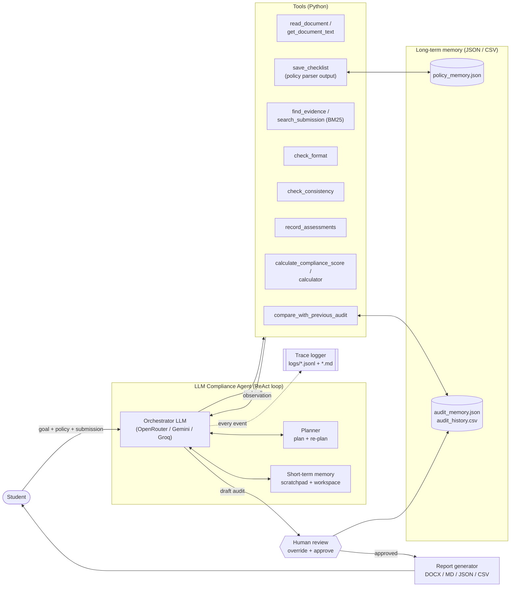
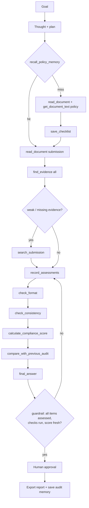

# Architecture

## System architecture



## Tool flow (one audit)



## ReAct message protocol

Every LLM turn is one JSON object:

```json
{"thought": "Evidence for R07 is weak, the log only shows web_search.",
 "action": "search_submission",
 "action_input": {"query": "calculator tool call"}}
```

The first turn also carries `"plan": [...]`. The loop ends with
`{"thought": "...", "final_answer": "..."}` - which is rejected by a guardrail
until every requirement has a verdict and the format / consistency / scoring
tools have run.

## Memory

| Type | Where | What |
|---|---|---|
| Short-term (context) | chat messages | thoughts, actions, observations; older observations are compressed to save tokens |
| Working memory | `Workspace` object | loaded documents, checklist, evidence, verdicts, scores |
| Policy memory | `memory/policy_memory.json` | checklist + rubric + format rules per policy file hash |
| Audit memory | `memory/audit_memory.json`, `audit_history.csv` | approved audits, used for version comparison |
